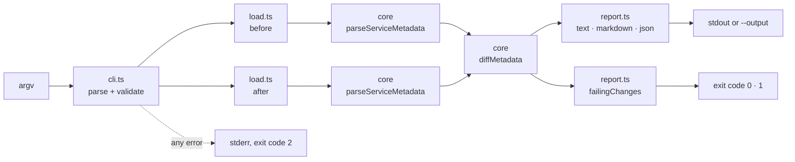

# Architecture

How `odata-diff` turns two `$metadata` documents into an exit code. Read this before changing a rule or adding an option.

## One run



1. **`cli.ts`** reads the arguments with `node:util` `parseArgs` and checks every value before the first request.
2. **`load.ts`** loads both sides in parallel, from a file or a URL, and rejects anything that is not `$metadata`.
3. **`core/csdl-json.ts` and `core/metadata.ts`** parse each side into a `MetadataIndex`.
4. **`core/metadata-diff.ts`** compares the two indexes and returns `MetadataChange[]`, sorted by severity and target.
5. **`report.ts`** renders the report and decides which changes fail the run.
6. **`cli.ts`** writes the report and returns the exit code. **`bin.ts`** puts it into `process.exitCode`.

## Modules

| File | Responsibility | Never |
| --- | --- | --- |
| `src/bin.ts` | wires `run` to Node.js: files, `fetch`, stdout and stderr, version | contains logic |
| `src/cli.ts` | arguments, validation, the order of a run, exit codes, `--help` | touches the disk or network directly |
| `src/load.ts` | sources: file or URL, `$metadata` URL, headers, "not a `$metadata` document" | puts header values into messages |
| `src/report.ts` | text, Markdown, JSON; EN/DE texts; pass or fail | does I/O |
| `src/core/xml.ts` | XML tokenizer without dependencies | throws on malformed input |
| `src/core/metadata.ts` | EDMX (V2 and V4) → `MetadataIndex` | throws |
| `src/core/csdl-json.ts` | CSDL JSON → `MetadataIndex`; `parseServiceMetadata` picks the parser | throws |
| `src/core/metadata-diff.ts` | `MetadataIndex` × 2 → `MetadataChange[]` with severity | knows about output formats or languages |

The arrows point one way: `cli` → `load`, `report` → `core`. The core knows nothing about the command line. It runs unchanged in the ODataTailor browser extension, where it compares a system with a system or a file with a system.

## Data model

```text
MetadataIndex                          MetadataChange
├─ odataVersion  '2.0' | '4.0'         ├─ severity  breaking | compatible | annotation
├─ entitySets[]  name, entityType      ├─ kind      property-removed, max-length, …
├─ entityTypes[] ┐ name, keys,         ├─ target    Orders/customer, Orders@UI.LineItem
├─ complexTypes[]┘ baseType,           ├─ before?   '80'
│                 properties[],        └─ after?    '40'
│                 navigations[]
├─ enumTypes[]   name, members[]
├─ operations[]  name, kind, isBound, bindingType, parameters[], returnType, httpMethod
├─ annotations[] target, term, qualifier, value
└─ warnings[]    what the parser could not read
```

Both parsers produce the same `MetadataIndex`, so the diff never needs to know whether a side was XML or JSON. Where the formats differ, the parser normalises:

| | EDMX | CSDL JSON |
| --- | --- | --- |
| `Nullable` absent | `true` | `false` (`$Nullable` absent means false) |
| type absent | – | `Edm.String` |
| collections | `Collection(…)` | `$Collection: true`, normalised to `Collection(…)` |

`parseServiceMetadata` picks the parser by content: text starting with `{` is CSDL JSON, everything else EDMX. File extensions don't matter.

## Parsing

- **Own XML tokenizer.** `xml.ts` is about 190 lines and has no dependency. The same core runs in a browser extension's service worker, where `DOMParser` doesn't exist, and the CLI stays a single file without `node_modules`. It covers what EDMX uses: elements, attributes, CDATA, comments and entities. It skips DOCTYPE and does no validation.
- **Never throws.** Malformed input gives a partial index plus `warnings`. For the extension this means "show what can be shown". For the CLI it would mean that an HTML login page looks like an empty service, and comparing against an empty service reports everything as removed. So `load.ts` rejects documents whose warnings say *not an EDMX / JSON / CSDL JSON document*, and the run ends with exit code 2 instead of 1.
- **V2 `sap:*` attributes** (`sap:label`, `sap:creatable` …) become annotations with `source: 'sap'`, so they are compared like V4 annotations.

## Comparing

`diffMetadata` walks the index in a fixed order: version, sets, types, enums, operations, annotations. For each element kind:

1. Build a `Map` by name for both sides.
2. If it exists only before, it was **removed**: breaking.
3. If it exists only after, it was **added**: compatible, unless it is a property or parameter with `Nullable=false`, which is breaking.
4. If it exists on both sides, compare field by field (`compareType`, `compareProperty`, `compareNavigation`, `compareOperation`, `compareEnum`).

Details that matter:

- **Names without namespace.** `shortType` turns `ZSRV.Order` into `Order` and `Collection(ZSRV.Item)` into `Collection(Item)`, while `Edm.*` stays as it is. Annotation targets and vocabulary terms are shortened the same way (`com.sap.vocabularies.Common.v1.Label` → `Common.Label`). This is what makes DEV against QAS work when the namespaces differ.
- **Facets as numbers.** A missing facet or `max` counts as infinite. Smaller is breaking, larger is compatible, and "set where there was none" is smaller than infinite, so it is breaking.
- **Operations** are keyed by `bindingType/name` when bound. V4 action and function imports are skipped, because they point to the actions and functions, which are compared themselves. In V2, function imports are the operations.
- **Sorting.** The result is sorted by severity, then target, so reports are stable and easy to review.

## Reporting

`report.ts` is pure: it takes `ReportInput` and returns a string. `KIND_TEXTS` holds one text per `ChangeKind` and language. Its type `Record<Lang, Record<ChangeKind, string>>` makes the compiler refuse a new kind without texts. The Markdown report reuses `metadataDiffMarkdown` from the core, the same function behind the extension's Markdown export.

`failingChanges` is where `--fail-on` happens. It compares ranks (breaking 0, compatible 1, annotation 2), so `--fail-on compatible` includes breaking.

## I/O and tests

`run(argv, io)` gets all I/O through `CliIo` (`readFile`, `writeFile`, `fetch`, `stdout`, `stderr`, `version`). It never throws and never exits the process. It returns the exit code. That keeps the tests honest without mocking modules: `test-io.ts` provides an in-memory `CliIo` and records every request, and `cli.test.ts` runs the real command end to end, including help, exit codes, `--output` and "the token never shows up in stderr".

Fixtures live in `src/__fixtures__`:

| File | Purpose |
| --- | --- |
| `v1.xml`, `v2-additive.xml`, `v2-breaking.xml` | small V2 service: additive and breaking next states |
| `cap-orders.xml`, `cap-orders.json` | the same CAP service as EDMX and as CSDL JSON |

`examples/` holds two larger real CAP states for trying the tool, and they are not used by the tests.

## Credentials and privacy, by design

| Risk | Design |
| --- | --- |
| token in the CI log | header values only go into `fetch`. `parseHeaders` reports a malformed header by position, never by value. |
| token in a public PR comment | reports show URLs through `displayName`, without user info and query string |
| session details from an error page | the body of a non-2xx response is not read |
| data leaving the machine | no telemetry, no update check. `fetch` is only called with the URLs from the command line. |
| executing content | none: XML and JSON are read as data, with no `eval` and no external entities |

## Build

`vite build` bundles `src/bin.ts` with everything it imports into `dist/cli.js`:

- `build.ssr` with `ssr.noExternal: true` puts the core into the bundle, while Node.js built-ins stay external.
- `target: 'node20'`, ES module, with a `#!/usr/bin/env node` banner.
- The bundle is not minified and ships with a source map, so stack traces stay readable.

`package.json` declares `bin: { "odata-diff": "dist/cli.js" }` without `./`, because npm 11 drops a `bin` path with `./` when publishing (`package.test.ts` guards this).

## Adding or changing a rule

1. **Core:** add the kind to `ChangeKind` and detect it in `metadata-diff.ts`, with its severity and a comment saying *why* it has that severity.
2. **Texts:** add it to `KIND_TEXTS` in `report.ts`, in English and German. The compiler insists.
3. **Tests:** add a fixture or extend one, and add a `cli.test.ts` case that checks the exit code.
4. **Docs:** update the tables in `docs/rules.md`, the `kind` list in `docs/reports.md`, and `README.md` if the summary table changes.
5. **Version:** a new kind goes in a minor version, and a stricter severity for an existing kind in a major version (see the README, *Versioning*).

## Where the code comes from

This repository is generated from the ODataTailor monorepo. `src/core/` is `packages/odata-core/src` there, shared with the browser extension and covered by several hundred more tests. Pull requests here are applied upstream, see [CONTRIBUTING.md](CONTRIBUTING.md).
